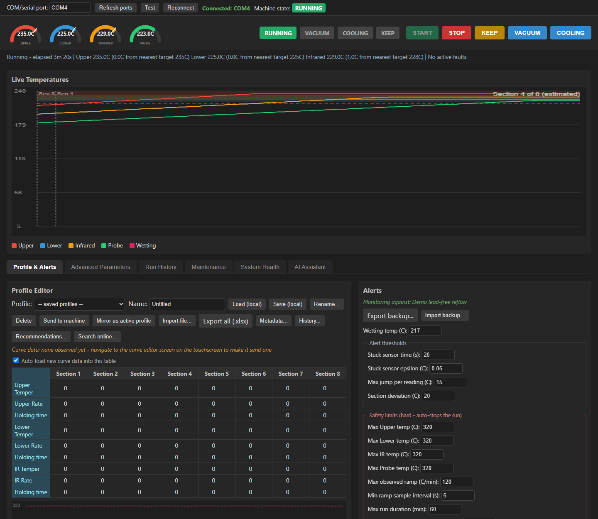
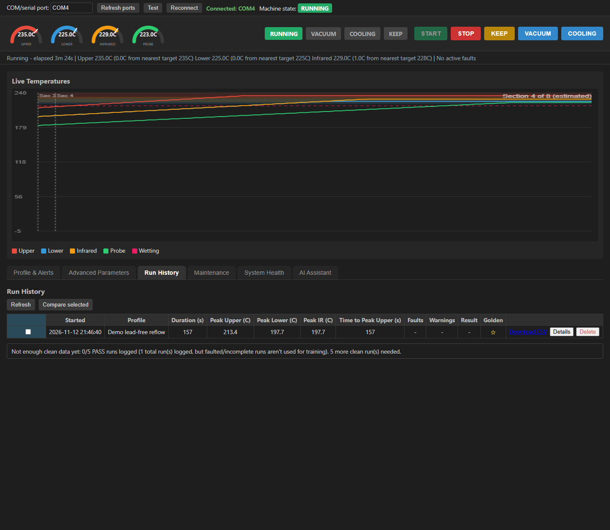
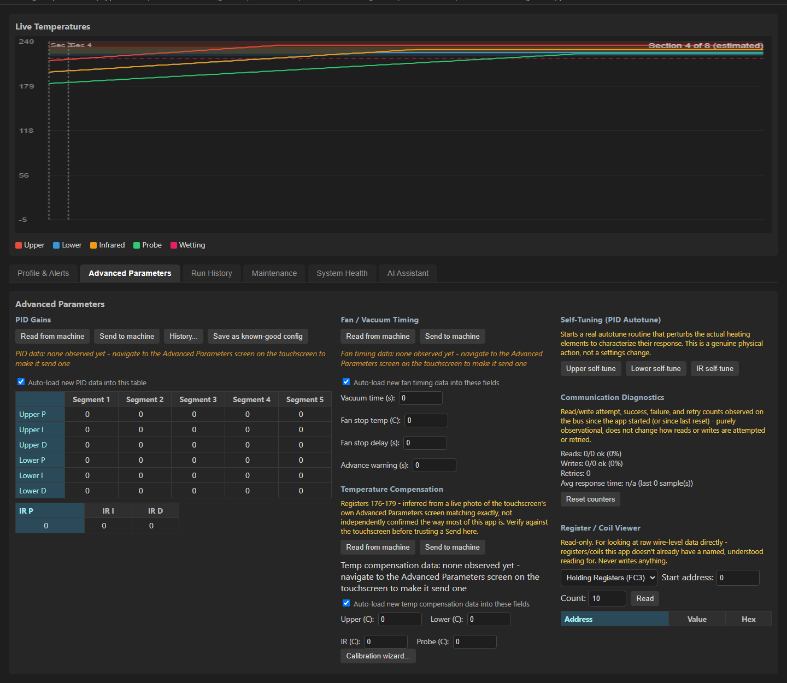

# LY-R690 web control panel

External monitoring and control software for an **LY-R690 BGA rework station**, talking Modbus RTU over RS485.
A Flask web app runs on a Raspberry Pi wired to the machine's RS485 bus; a Windows desktop app (PySide6,
`pc-app/src/main_window.py`) shares the same core modules. Features: live temperatures, curve/PID/fan-timing
send with read-back verification, profile library with web-search + local-LLM (Ollama) assisted profile
suggestions, run logging and summaries, a safety layer (limits, ramp-rate, fault handling), and notifications.

> ## WARNING - read before use
> This software **can switch the machine's heaters on**. It is an unofficial, community project, is not
> affiliated with or endorsed by the manufacturer, has had limited real-hardware verification, and comes with
> **no warranty** (see LICENSE). Never leave a running machine unattended. The software safety checks
> complement - they do not replace - the machine's own protections and your own supervision. Behavior such as
> "does writing a self-tune coil off really cancel an autotune" has **not** been verified on hardware.
> AI-estimated profiles are suggestions, not tested process recipes.

## Screenshots
Taken from the built-in simulator (`python tools/demo_server.py`, then open http://127.0.0.1:8080 - no hardware
needed, nothing is ever sent to a real machine), so the data below is simulated.





## Security
The web panel requires an **access token**. On first start it creates `pc-app/auth_config.json` (owner-only
permissions) and logs the token once: `journalctl -u ly-r690-web | grep "access token"`. Open the page, enter the
token on `/login`; scripts may send `Authorization: Bearer <token>`. To rotate: delete `auth_config.json` and
restart. Requests from the Pi itself (loopback, with no proxy headers) are trusted so local tooling works.
Failed logins are rate-limited. The server speaks plain HTTP - **do not expose port 8080 to the internet**; use
a VPN such as Tailscale, or a reverse proxy with TLS. `LY_R690_AUTH=off` disables auth (not recommended).

## Hardware and wiring
**Read this before connecting anything.** Everything below was worked out on one machine; verify it on yours
(listen first, never transmit blindly).

- **Bus:** the machine's touchscreen (HMI) is the Modbus RTU **master** and polls the control board over a 2-wire
  RS485 link (touchscreen DB9 "COM" port <-> control board DB9, pins 7/8 on the author's machine).
  Serial settings: **9600 baud, 8 data bits, no parity, 1 stop bit; slave address 1**. Modbus addresses are
  the HMI tag number minus 1 (tag `M172` = coil 171). Full register map and evidence:
  `docs/06-modbus-register-map.md`.
- **One adapter, in parallel:** use a single USB-to-RS485 adapter (the author uses a DTECH adapter, an FTDI chip
  on the Pi) connected **in parallel** with the touchscreen on the A/B lines - tap the existing link, do not
  replace or cut it. Connect a common ground if your adapter needs one. A/B labelling varies between
  manufacturers: if you see garbage or nothing, swap A and B.
- **Why it listens *and* sends:** the app does not need a separate "sniffer". The same adapter first just
  *listens* (`passive_listener.py`, and the passive reader inside `machine_bus.py`) to learn live temperatures and
  status from the HMI's own traffic without adding any. Commands (start, stop, curve/PID writes) are sent by
  `MachineBus` only after waiting for a quiet gap on the bus, then confirmed by the board's acknowledgement;
  a lock keeps two commands from interleaving. The bus is nearly always busy, so large writes are chunked and
  retried.
- **Not everything can be read back:** the board's stored curve cannot be reliably read over Modbus, so the app
  reports whether a send was *acknowledged*, never what the board "really" holds.
- **First-time bring-up on a different machine:** (1) with the machine on, run `tools/capture-modbus.ps1`
  (read-only; it never writes) at each candidate baud rate and look for repeating frames with a valid CRC16;
  (2) compare the frames with `docs/06-modbus-register-map.md`; (3) only then run the web app, check live
  readings against the touchscreen, and try a harmless write (e.g. the vacuum coil) before any heating.
- **Safety:** wiring mistakes can corrupt the touchscreen's communication. Do this with the machine idle and
  supervised.

## Install on the Pi
Needs a Raspberry Pi (or any Linux box) with Python 3.10+, git, and the USB-RS485 adapter wired as described above.
```bash
git clone https://github.com/thelazy3d/ly-r690-control.git ~/ly-r690
cd ~/ly-r690
./install.sh                      # or: ./install.sh --port /dev/ttyUSB0   (--dry-run shows what it would do)
```
`install.sh` creates a virtualenv, installs `pc-app/requirements-web.txt`, writes and enables a systemd service
that runs as your user, starts it, and prints the **URL and access token**. Prefer manual steps? Do the same by
hand: `python3 -m venv pc-app/venv && pc-app/venv/bin/pip install -r pc-app/requirements-web.txt`, edit
`pc-app/ly-r690-web.service` (User=, paths, serial port), copy it to `/etc/systemd/system/`, then
`sudo systemctl enable --now ly-r690-web`. The path must not contain spaces.

Update later with `git pull` then `sudo systemctl restart ly-r690-web` (or press *Restart service* on the System
Health tab). `tools/deploy-to-pi.ps1` is an alternative that pushes code from a Windows PC over ssh.

## Windows desktop app (optional)
The same core also ships as a PySide6 desktop app that talks to the machine directly over a local COM port.
- **Prebuilt:** download `LY-R690-Control-windows.zip` from the Releases page, unzip, run `LY-R690 Control.exe`.
  It is unsigned, so Windows SmartScreen may warn - choose *More info -> Run anyway*, or build it yourself.
- **From source:** `pip install -r pc-app/requirements-desktop.txt`, then `python pc-app/src/main_window.py COM4`.
- **Build the .exe:** `pip install pyinstaller` and, inside `pc-app/`, `pyinstaller "LY-R690 Control.spec"`.
Do not run the desktop app and the Pi service against the same machine at the same time - only one program
should own the RS485 adapter.

## Tests
```bash
cd pc-app && python -m pytest tests -q
```
(needs pymodbus, pyserial, Flask, openpyxl; the desktop-app tests also need PySide6 and pyqtgraph.)

## Layout
- `pc-app/src/machine_bus.py` - serial bus: passive listener plus coordinated, verified reads/writes
- `pc-app/src/modbus_client.py` - register map and constants; `docs/06-modbus-register-map.md` explains it
- `safety_limits.py`, `fault_manager.py`, `machine_state.py`, `preflight.py` - safety layer
- `web_server.py`, `web_auth.py`, `static/`, `templates/` - the Pi web app
- `profile_*.py` - profile store, import, validation and online/LLM suggestion

Your own settings, saved profiles, API keys and run logs are never part of this repository (see `.gitignore`).
